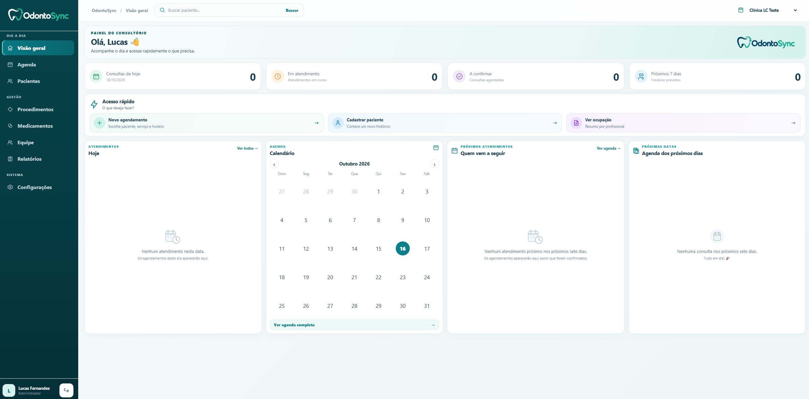
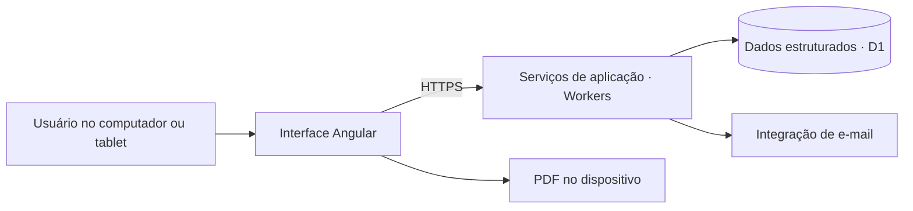

# 🦷 OdontoSync — Case study

**Sistema web de gestão odontológica, já utilizado por um consultório com dois dentistas.**

O OdontoSync reúne agenda por profissional, cadastro de pacientes, prontuário, medicamentos e documentos clínicos em uma interface responsiva. Este repositório apresenta o produto, sua arquitetura e as decisões de implementação para avaliação técnica e apresentação profissional.

> 🏥 **Uso real:** o sistema está em uso em um consultório com **2 dentistas**. A identidade do consultório, dos profissionais e dos pacientes é preservada neste material.

> 🔒 **Escopo público:** este é um case study técnico e visual. O código-fonte operacional e seu histórico permanecem em um repositório privado.

*Captura demonstrativa de um ambiente de teste, sem registros de pacientes. Os valores e o nome do consultório exibidos na imagem não representam a operação real.*

## 🧭 Navegação

- [Contexto e problema](#contexto)
- [Solução desenvolvida](#solucao)
- [Tecnologias](#tecnologias)
- [Arquitetura](#arquitetura)
- [Decisões técnicas](#decisoes)
- [Fluxos do produto](#fluxos)
- [Qualidade e evolução](#qualidade)
- [Competências demonstradas](#competencias)
- [Documentação](#documentacao)
- [Sobre este repositório](#repositorio)

## 🎯 Contexto e problema

A rotina de um consultório envolve coordenar os horários dos profissionais, manter o histórico dos pacientes e emitir documentos com informações consistentes. Com dois dentistas utilizando o sistema, também é necessário distinguir os atendimentos e controlar o acesso às informações clínicas.

O projeto foi desenvolvido para centralizar essa operação, considerando quatro necessidades:

1. **Organização:** acompanhar agenda, disponibilidade e situação dos atendimentos por profissional.
2. **Continuidade clínica:** reunir anamnese, evoluções e procedimentos no prontuário do paciente.
3. **Consistência documental:** reutilizar dados cadastrais e instruções de medicamentos, com possibilidade de ajustes em cada emissão.
4. **Controle e manutenção:** aplicar permissões, registrar ações relevantes e evoluir a aplicação de forma versionada.

## ✨ Solução desenvolvida

| Área | Recursos implementados |
| --- | --- |
| **📊 Painel** | Indicadores do dia, calendário, próximos atendimentos e atalhos para as ações frequentes. |
| **📅 Agenda** | Visões mensal e diária, horários por profissional, bloqueios, acompanhamento do atendimento e controle de conflitos de horário. |
| **👤 Pacientes** | Cadastro, busca, edição e acesso ao histórico de acompanhamento. |
| **🩺 Prontuário** | Anamnese estruturada, evolução clínica, procedimentos por visita e correções com justificativa. |
| **💊 Medicamentos** | Modelos de apresentação e forma de uso, com dose, via, intervalo, duração e instruções complementares. |
| **📝 Receitas e exames** | Receituário e pedido de radiografia com seleção de opções, texto livre, identificação automática, data, assinatura na tela e PDF. |
| **📄 Outros documentos** | Termos de consentimento, autorização de imagem e comprovantes de atendimento pago. |
| **👥 Gestão de acesso** | Contas individuais e perfis de administrador, dentista e recepção. |
| **🔐 Operação** | Segundo fator, recuperação de conta, auditoria e exportação cifrada por consultório. |

Detalhamento: [funcionalidades](docs/funcionalidades.md).

## 🧰 Tecnologias

| Camada | Stack | Aplicação no projeto |
| --- | --- | --- |
| Interface | **Angular, TypeScript e SCSS** | Componentes, formulários, estado da interface e adaptação a telas de diferentes tamanhos. |
| Serviços | **Cloudflare Workers e TypeScript** | Validação, autenticação, autorização e regras de negócio no servidor. |
| Dados | **Cloudflare D1 / SQLite** | Persistência estruturada e evolução por migrações versionadas. |
| Documentos | **pdf-lib** | Geração de documentos PDF no navegador. |
| Integração | **Google Apps Script** | Envio de e-mails de confirmação de conta e recuperação de senha. |
| Entrega | **Wrangler, Git e GitHub Actions** | Publicação serverless, versionamento e validação automatizada. |

## 🏗️ Arquitetura

A interface conduz os fluxos de atendimento; os serviços validam as operações e aplicam as permissões. A persistência mantém o vínculo das informações com o consultório e com os registros correspondentes.

O produto organiza dados por consultório. O uso atual é de um consultório com dois dentistas; essa organização arquitetural não representa uma alegação de escala já comprovada em múltiplas clínicas.

Detalhamento: [arquitetura](docs/arquitetura.md).

## ⚖️ Decisões técnicas

| Decisão | Objetivo | Aspecto considerado |
| --- | --- | --- |
| **Interface e API na mesma implantação** | Simplificar entrega e operação. | Manter responsabilidades separadas dentro do projeto. |
| **Permissões verificadas no servidor** | Controlar o acesso às informações clínicas e administrativas. | Restrições visuais precisam ser acompanhadas de validação dos serviços. |
| **Dados preservados na emissão** | Manter documentos consistentes após mudanças nos cadastros. | Armazenar os dados utilizados em cada documento. |
| **Rascunhos e documentos assinados** | Permitir preparação e revisão pelo responsável. | Receitas e radiografias podem ser corrigidas com confirmação por senha; a assinatura anterior é substituída. |
| **PDF no navegador** | Gerar e baixar o arquivo no dispositivo. | Tratar paginação, conteúdo extenso e inspeção visual. |
| **Modelos de medicamentos** | Reaproveitar orientações cadastradas. | Ajustes individuais na receita preservam o modelo original. |
| **Migrações e controle de versão** | Evoluir um sistema que já está em uso. | Avaliar compatibilidade e preservação dos registros existentes. |

Discussão completa: [decisões técnicas](docs/decisoes-tecnicas.md).

## 🔄 Fluxos do produto

- **Agendamento:** selecionar paciente, profissional, procedimento e horário; acompanhar a situação do atendimento.
- **Atendimento:** consultar a anamnese, registrar evolução e procedimentos e manter o histórico do paciente.
- **Receita:** selecionar medicamentos, ajustar a forma de uso, revisar, assinar e gerar o PDF.
- **Radiografia:** marcar exames e regiões, escrever objetivo e observações, assinar e gerar o documento.

Veja o passo a passo em [como o sistema funciona](docs/como-funciona-o-sistema.md).

## 🧪 Qualidade e evolução

A validação do projeto combina verificação de tipos, compilação da interface, testes de integração e revisão visual. Os cenários exercitados incluem controle de acesso, separação entre consultórios de teste, preservação dos documentos, assinaturas na interface e geração de PDFs com conteúdo extenso.

O fluxo de integração contínua do projeto privado verifica tipos e compilação. Testes de integração, e-mail e PDFs são executados separadamente. As telas também foram conferidas em navegador com dimensões de tablet.

**Uso real e validação têm escopos diferentes:** a adoção por um consultório com dois dentistas está estabelecida; a revisão independente de segurança, os ensaios ampliados de recuperação e a validação em iPad físico permanecem como frentes de evolução. Não são apresentados indicadores de produtividade, volume de pacientes ou desempenho sem medição documentada.

## 💼 Competências demonstradas

Este case permite avaliar a implementação de uma aplicação completa e sua evolução para atender uma rotina real:

- **Engenharia de produto:** transformação de necessidades do consultório em fluxos de agenda, prontuário e documentos.
- **Desenvolvimento web:** construção de componentes, formulários e interface responsiva em Angular e TypeScript.
- **Backend e dados:** serviços serverless, validação, autorização, regras de negócio e persistência relacional.
- **Consistência e rastreabilidade:** controle de alterações, preservação dos dados de emissão e registros de auditoria.
- **Qualidade de entrega:** testes por cenário, inspeção visual de PDFs, versionamento e publicação controlada.
- **Documentação:** comunicação de responsabilidades, decisões, limitações e aspectos operacionais.

## 📚 Documentação

| Documento | Conteúdo |
| --- | --- |
| [🏗️ Arquitetura](docs/arquitetura.md) | Componentes, responsabilidades e organização dos dados. |
| [✨ Funcionalidades](docs/funcionalidades.md) | Módulos, perfis e escopo funcional. |
| [🔄 Como funciona](docs/como-funciona-o-sistema.md) | Fluxos de agendamento, atendimento e emissão de documentos. |
| [⚖️ Decisões técnicas](docs/decisoes-tecnicas.md) | Motivações, implicações e compromissos de implementação. |
| [🛡️ Segurança e operação](docs/seguranca-e-operacao.md) | Controles de alto nível, validação e manutenção. |
| [🗂️ Estrutura do case study](docs/estrutura-do-projeto.md) | Organização e limites deste repositório público. |

## 🔒 Sobre este repositório

O conteúdo público é composto por documentação e uma imagem demonstrativa. Não inclui código-fonte operacional, histórico do repositório privado, configurações de produção, identificadores de infraestrutura, credenciais, dados de pacientes, bancos ou backups.

O objetivo é apresentar **escopo, implementação, decisões e experiência de manutenção de um sistema em uso**, preservando a operação do consultório e a propriedade intelectual do produto.

[👤 Perfil profissional de Lucas Fernandes](https://github.com/Lcsf-dev)
