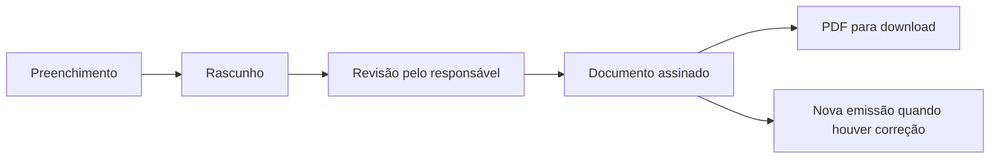

# 🔄 Como o OdontoSync funciona

## 🔐 Acesso ao ambiente

A pessoa entra com sua conta individual. O sistema identifica seu perfil e o consultório ao qual tem acesso. Informações clínicas e ações administrativas respeitam essas permissões.

## 📅 Agendamento

1. Localizar o paciente ou realizar um cadastro rápido.
2. Selecionar profissional, procedimento, data e horário.
3. Validar a disponibilidade e registrar a consulta.
4. Acompanhar a situação do atendimento pela agenda e pelo painel.

O uso por um consultório com dois dentistas exige que a agenda e os registros distingam o profissional responsável por cada atendimento.

## 🩺 Atendimento e continuidade

1. Abrir o prontuário do paciente autorizado.
2. Consultar ou atualizar a anamnese.
3. Registrar a evolução do atendimento.
4. Informar procedimentos, região atendida e observações.
5. Consultar o histórico em visitas posteriores.

Quando há correção de um procedimento realizado, o fluxo exige justificativa e registra a revisão para manter a rastreabilidade da alteração.

## 💊 Prescrição

O profissional abre o receituário no prontuário, seleciona medicamentos ou preenche o conteúdo manualmente. As orientações do catálogo ajudam no preenchimento e podem ser ajustadas para a receita em preparação.

Após a revisão, o profissional pode salvar um rascunho ou coletar a assinatura na tela. O documento fica no histórico do paciente e pode ser convertido em PDF.

## 🩻 Solicitação de exames

O pedido de radiografia permite marcar tipos de exame, indicar regiões, registrar o objetivo e acrescentar observações. A identificação e a data são preenchidas pelo sistema; a finalização segue o fluxo de assinatura e geração do PDF.

## 📄 Ciclo de receitas e radiografias

Os dados utilizados em cada emissão são preservados. Alterar posteriormente o cadastro do paciente ou do medicamento mantém o conteúdo do documento anterior.

## 🗃️ Consulta e acompanhamento

O painel apoia a organização do dia, enquanto o prontuário concentra o histórico do paciente. As informações persistidas podem ser consultadas nos atendimentos seguintes, respeitando o acesso de cada pessoa.

[← Voltar ao case study](../README.md)
